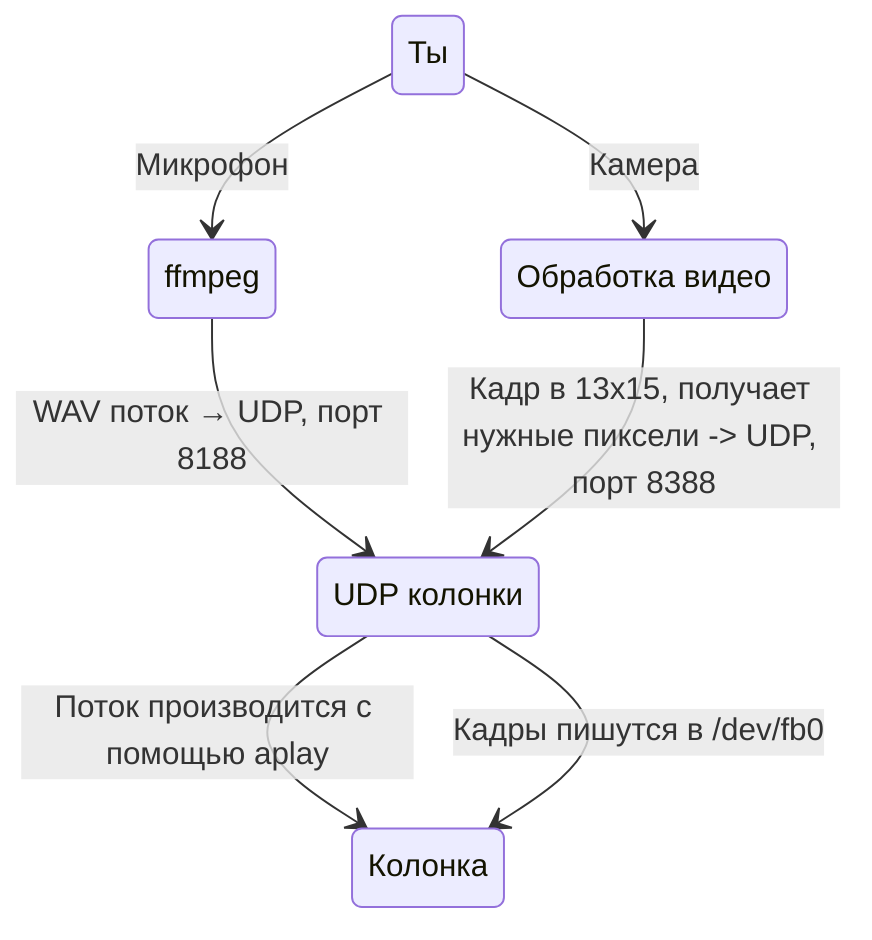

<h1 style="text-align:center;">Камера + микрофон для Яндекс Станции 2</h1>

## Содержание
1. [Как работает](#1-Как-работает)
2. [Установка](#2-Установка)

---
## 1. Как работает
Вот диаграма чтобы было понятнее как скрипт работает

---
## 2. Установка
1. `git clone https://github.com/FelicityRUX/yandex-webcam.git`
2. host.py должен запускаться с пк
3. yandex.py должен запускаться с колонки

> [!TIP]
> Не сработало? Поменяй последовательность запуска скриптов.
---
написал крутой ридми как вам
